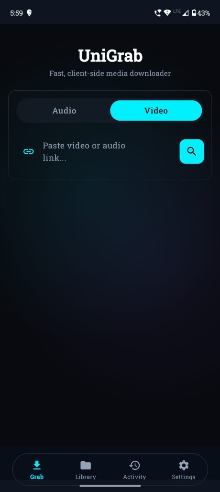
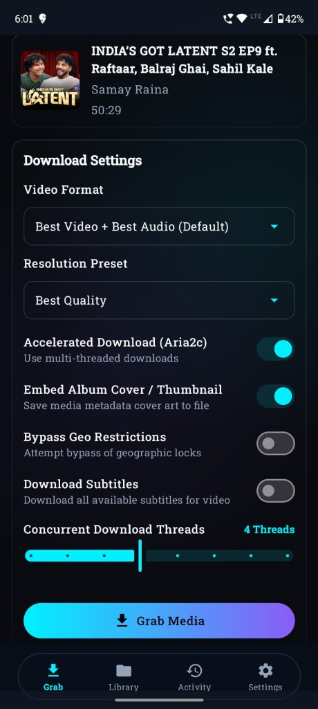
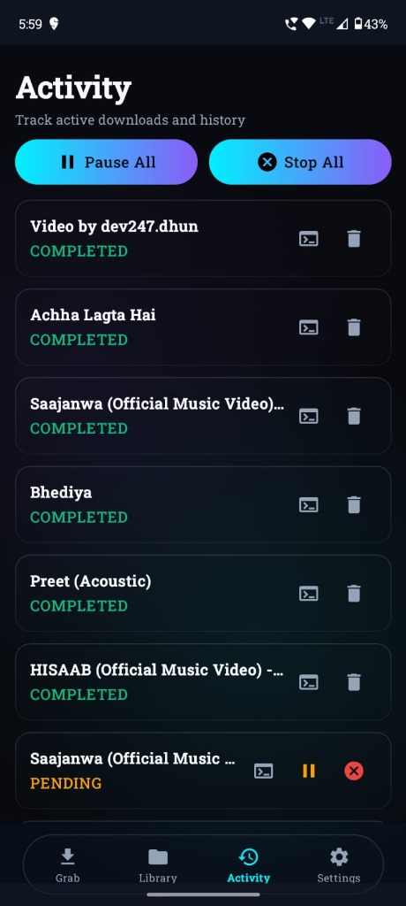
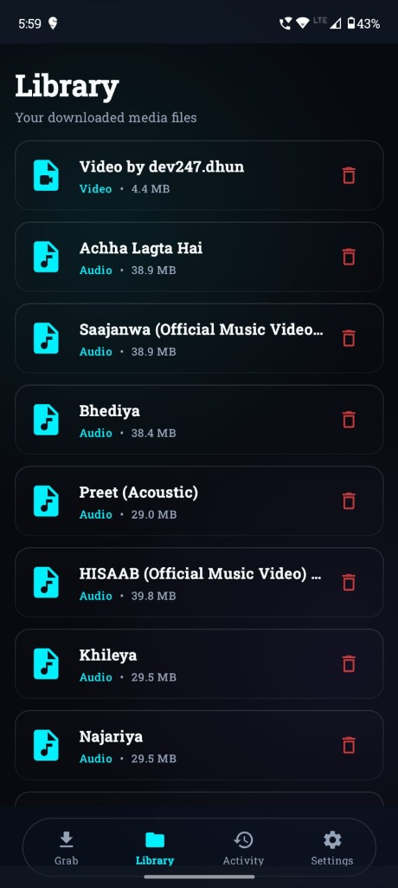
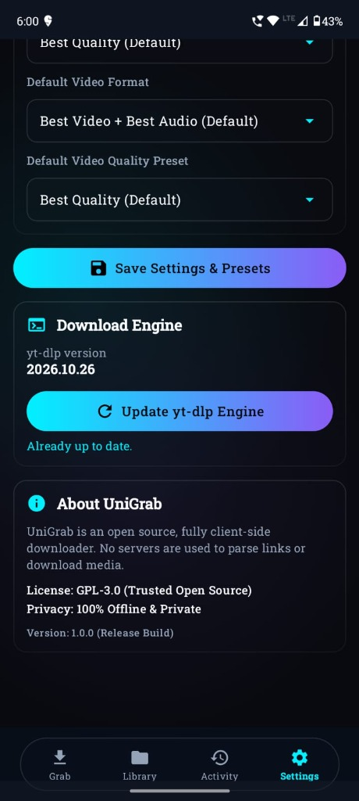

# UniGrab

<p align="center">
  
</p>

<p align="center">
  <b>Fast, 100% client-side media downloader for Android and CLI.</b><br />
  Grab 4K video and lossless audio from 1,800+ sites with zero servers, zero ads, and multi-threaded Aria2c acceleration.
</p>

<p align="center">
  <a href="https://github.com/mksh2810/UniGrab/releases/latest"></a>
  <a href="https://github.com/mksh2810/UniGrab/blob/master/LICENSE"></a>
  <a href="https://github.com/mksh2810/UniGrab/releases/latest/download/UniGrab.apk"></a>
  <a href="https://github.com/sponsors/mksh2810"></a>
  <a href="https://github.com/ImranR98/Obtainium"></a>
  
</p>

---

## 📱 UniGrab for Android (Native App)

UniGrab is a modern, native Android application built with **Jetpack Compose (Material 3)**. It runs `yt-dlp` and `aria2c` directly on your device with **zero server dependencies** — ensuring total privacy and maximum download speeds.

<p align="center">
  
  
  
  
  
</p>

### Key App Features:
- **100% Client-Side:** No cloud servers or proxies. Connections go directly from the source to your phone storage.
- **Aria2c Multi-Threading:** Segmented chunk downloading saturates Wi-Fi and 5G cellular bandwidth.
- **Lossless Audio & 4K/8K Video:** Format conversion with automatic high-res album cover art and ID3 metadata tagging.
- **1,800+ Supported Sites:** YouTube (4K/60fps/Shorts), Spotify, Instagram Reels, TikTok, Twitter/X, SoundCloud, Twitch, and direct M3U8/HLS streams.
- **Real-Time Task Queue:** Pause, resume, and track active downloads with live process console logs.
- **Offline Media Library:** Saved directly to your device storage (playable in VLC, MX Player, or any media player).
- **1-Tap Engine Updater:** Update the core `yt-dlp` binary on-device anytime with one tap.

### 📥 Download & Install

| Method | Instructions |
|---|---|
| **Direct APK** | [**Download UniGrab.apk**](https://github.com/mksh2810/UniGrab/releases/latest/download/UniGrab.apk) from the latest release and install directly. |
| **Obtainium** *(Auto-updates)* | Add `https://github.com/mksh2810/UniGrab` into [Obtainium](https://github.com/ImranR98/Obtainium) for 1-tap installation and automatic background updates. |
| **F-Droid / IzzyOnDroid** | Fastlane metadata is included in `fastlane/metadata/android/` for F-Droid and IzzyOnDroid inclusion. |

---

## 💻 UniGrab CLI (Terminal / Desktop)

- Explicit modes: `m` for music (songs, albums, playlists, podcasts/shows), `v` for video.
- Separate output folders: `downloads/music` and `downloads/videos`.
- **1,800+ supported sites** via yt-dlp, including YouTube, Instagram, Vimeo, TikTok, Twitch, Reddit, Twitter/X, Facebook, SoundCloud, and many more.
- **Internet Archive** (archive.org) public domain media with rich metadata extraction.
- **M3U/M3U8 playlist support** for IPTV streams, HLS playlists, and local media lists.
- Playlist, album, and show downloads create a nested folder with the collection name.
- Music formats: `aac`, `alac`, `flac`, `m4a`, `mp3`, `ogg`, `opus`, `vorbis`, `wav`.
- Video containers: `mp4`, `mkv`, `webm`.
- Video quality from `144p` to `8k`, plus `best` for highest available.
- **Cookie support** for authenticated downloads (age-restricted content, subscriber VODs).
- **Geo-bypass** for region-restricted but freely available content.
- **Subtitle downloads** for videos when available (automatically non-fatal).
- Adaptively sized real-time progress bars (up to 100 characters wide).
- File names use only the media title; metadata is written into file tags when possible.
- Uses `yt-dlp` and `imageio-ffmpeg` from `requirements.txt`.

## Installation

### On Android (via Termux)
1. Install [Termux from F-Droid](https://f-droid.org/en/packages/com.termux/).
2. Open Termux and set up Python, Git, and FFmpeg:
   ```bash
   pkg update && pkg install python git ffmpeg -y
   termux-setup-storage
   ```
3. Clone and install UniGrab:
   ```bash
   git clone https://github.com/mksh2810/UniGrab.git
   cd UniGrab
   pip install -r requirements.txt
   ```
4. Run UniGrab interactively:
   ```bash
   python unigrab.py
   ```

### On Windows / macOS / Linux
```bash
python -m pip install -r requirements.txt
```

## Usage

Start the interactive downloader:

```powershell
python unigrab.py
```

Choose music or video, paste the link, and UniGrab will continue with the download.

You can also use direct commands. The first argument after `download` chooses what kind of file to download:

| Mode | Use for | Output folder |
| --- | --- | --- |
| `m` | Songs, albums, playlists, podcasts, and audio shows | `downloads/music` |
| `v` | Videos from supported websites | `downloads/videos` |

Music:

```powershell
python unigrab.py download m "https://music.youtube.com/watch?v=..." --format mp3 --quality high
```

Video:

```powershell
python unigrab.py download v "https://www.youtube.com/watch?v=..." --video-format mp4 --video-quality 1080p
```

Video mode can download from supported sources such as YouTube, Instagram, Vimeo, X/Twitter, Facebook, Twitch, TikTok, and many more when your access is permitted. Dailymotion is intentionally not supported.

Download in 4K or best available quality:

```powershell
python unigrab.py download v "https://www.youtube.com/watch?v=..." --video-quality 4k
python unigrab.py download v "https://www.youtube.com/watch?v=..." --video-quality best
```

Internet Archive public domain content:

```powershell
python unigrab.py download v "https://archive.org/details/BigBuckBunny_124" --video-quality 720p
```

M3U/IPTV playlists (remote or local):

```powershell
python unigrab.py download v "https://example.com/streams.m3u8"
python unigrab.py download v "./my_playlist.m3u"
```

## Advanced Options

### Cookies for authenticated content

Use `--cookies` to pass a Netscape-format cookies.txt file for content that requires login (age-restricted YouTube, subscriber Twitch VODs you have access to, etc.):

```powershell
python unigrab.py download v "https://www.youtube.com/watch?v=..." --cookies cookies.txt
```

Or set the environment variable for repeated use:

```powershell
$env:UNIGRAB_COOKIES="C:\path\to\cookies.txt"
python unigrab.py download v "https://www.youtube.com/watch?v=..."
```

### Geo-bypass

For content freely available in other regions but blocked in yours:

```powershell
python unigrab.py download v "URL" --geo-bypass
```

### Subtitles

Download subtitles along with video (converted to SRT and optionally burned in):

```powershell
python unigrab.py download v "URL" --subs
```

## Utility Commands

List supported formats and quality levels:

```powershell
python unigrab.py formats
```

List all supported sites (1,800+ via yt-dlp, plus UniGrab built-in resolvers):

```powershell
python unigrab.py sources
```

Check dependencies:

```powershell
python unigrab.py doctor
```

Windows users should quote URLs containing `&`:

```powershell
python unigrab.py download m "https://music.youtube.com/watch?v=fwlJDTsmr58&list=RDAMVMfwlJDTsmr58" --format mp3
```

## Spotify and Apple Music Metadata

Spotify and Apple Music streaming audio is not downloaded from those services. They are used only as metadata sources where public metadata or official APIs allow it.

For full Spotify playlist/album metadata:

```powershell
$env:SPOTIFY_CLIENT_ID="your-client-id"
$env:SPOTIFY_CLIENT_SECRET="your-client-secret"
```
